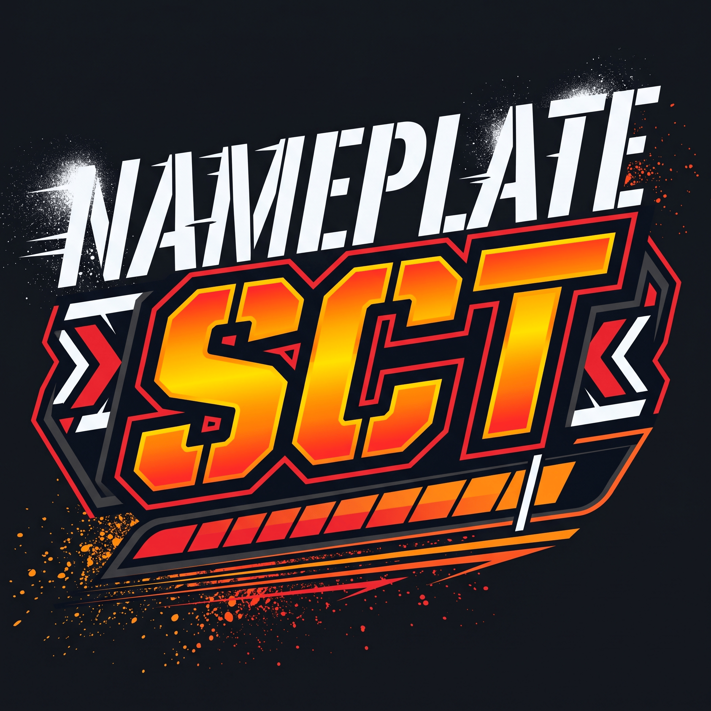

<div align="center">



# <span style="color:#FF8D0A">NameplateSCT</span>

**Your damage numbers, on the nameplate they landed on.**

[](CHANGELOG.md)
[](LICENSE)
[](https://www.lua.org/)
[](#-compatibility)

</div>

---

<span style="color:#FF8D0A">**NameplateSCT**</span> draws scrolling combat text out of the unit it
actually happened to, instead of one pile of numbers in the middle of the screen. Big crits on
the mob you are fighting, greyed-out numbers on the ones you are not, damage you take on your own
plate — and an optional screen area for when you play without nameplates.

- 🎯 **Anchored to the right plate** — every number follows the unit it belongs to.
- 🕶️ **Custom shadow** — size, distance, angle, opacity and colour, per number.
- 🖥️ **A real settings window** — 1200×800, searchable, live counters, live preview, `/nsct`.
- 🔌 **Profiles, filters, Masque, LibSharedMedia fonts** — it fits into a normal addon setup.
- ✅ **Works on Retail, Classic and Forever** — including the restricted-client combat path.

## ✨ Highlights

| | |
| :--- | :--- |
| 🎯 **Directional text** | Damage is drawn from the plate that took it, on target or off target. |
| 🕶️ **Shadow you control** | Size, distance, angle, opacity, colour. Off by default, exactly as before. |
| 🧪 **Live preview** | The Appearance page shows your number *and* the off-target style while you tune it. |
| 🖥️ **Dashboard** | Events, numbers, drops, six automatic checks, counters, shadow and quick settings. |
| 🔎 **Search** | Type in the title bar; every matching setting appears as a live control. |
| 🎨 **Colour swatches** | Pick a colour from a palette, or type the hex value. |
| 💾 **Backup** | Export your look as a text block and paste it back. |
| 🎨 **Your type** | Any LibSharedMedia font, outline presets, text shadow, per-school colours. |
| ⚕️ **Healing** | Incoming heals with their own colour, crit colour, animation and switch. |
| 🎚️ **Kinds of hit** | Melee, spell, ranged, DoT, heals and pet damage each switch on their own. |
| 🏷️ **Icons** | Spell icons on the number, with Masque skinning if you use it — off by default. |
| 🎞️ **Animations** | Vertical, fountain, rainfall and fireworks, each tuned per hit type. |
| 🚫 **Filters** | Hide specific spells or NPCs, or allow only the listed ones. |
| 💾 **Profiles** | AceDB profiles: new, copy, delete, reset — settings follow the profile. |

## 🧩 Compatibility

| Client | Interface | Combat source |
| :--- | :--- | :--- |
| Retail (Midnight) | 120005 | combat log, or `UNIT_COMBAT` where restricted |
| Retail (11.x) | 110207 | combat log |
| <span style="color:#FF8D0A">Forever (Camelot)</span> | 16001 | `UNIT_COMBAT` (combat log is not available) |
| Mists | 50504 | combat log |
| Cataclysm | 40402 | combat log |
| Wrath | 30405 / 38002 | combat log |
| TBC | 20505 / 20506 | combat log |
| Vanilla | 11508 / 11509 | combat log |

On clients that hide the combat log, the addon automatically switches to `UNIT_COMBAT` and turns
the damage amount into a secret value it never does maths on. A secret amount is passed straight
to the font, so nothing is ever formatted, compared or cached in a way that would break.

## 📥 Install

**CurseForge / Wago** — press *Install*; updates arrive the usual way.

**Manual**

1. Download and unzip.
2. Copy the `NameplateSCT` folder into:
   `World of Warcraft\_retail_\Interface\AddOns\` (or `_classic_`, `_forever_`, …)
3. Restart the client or type `/reload`.

The addon is enabled by default. If nothing appears, check **AddOns** on the character screen — a
disabled addon draws nothing at all.

## ⚙️ First run

Type **`/nsct`** (or open **Menu → Options → AddOns → NameplateSCT → Open dashboard**).

The dashboard tells you what is happening right now:

- **Events received** — the addon is being fed combat events.
- **Numbers drawn** — numbers actually reached a plate.
- **Combat source** — `UNIT_COMBAT` or combat log, per client.

If events stay at **0** after a fight, the source is the problem, not your styling. If events
climb but numbers stay at **0**, look at Filters, the damage threshold and the size floor.

## 🖥️ The dashboard

| Page | What it is for |
| :--- | :--- |
| 🏠 **Dashboard** | Health checks, counters, test numbers, shadow and quick settings |
| ⚙️ **General** | Where numbers appear, what counts, off-target text |
| 🔢 **Numbers** | Number style, sizes, opacity, hit filtering, size modifiers |
| 🎨 **Appearance** | Preview, font, outline, **shadow**, icons, colours |
| 🎞️ **Animations** | One animation per hit type, speed, fireworks |
| 📍 **Position** | Plate offsets, personal offsets, scatter, screen areas |
| 🚫 **Filters** | Spell and NPC lists, inverted modes |
| 💾 **Backup** | Export a settings block, or paste one back in |
| ℹ️ **About** | Version, client, profiles, reset |

Everything saves as you change it. `Reset page` restores one page; the profile reset on **About**
asks for a second click, because it erases every setting in the profile.

The window opens at **1200 × 800** and scales itself down if your screen is smaller, so it never
runs off the edge. The box in the title bar searches every setting: type `shadow`, and the shadow
options appear as live controls on one page. Escape clears the search and returns you to where you
were.

## 🩺 Diagnostics

The dashboard is a diagnostic tool, not just a settings page.

**Seven automatic checks** run continuously, each with a colour and a one-line fix:

- addon enabled
- event source subscribed
- enemy nameplates visible (skipped in screen mode)
- combat events arriving in the last 15 seconds
- numbers reaching the screen in the last 15 seconds
- Blizzard's own text not doubling up (read from the client's own combat-text frame, not from
  the addon's CVar write)
- no other addon drawing numbers (`PlateSCT`, `ClassicFCT`) — because "I turned it off and they
  still show" is usually a second addon

**Counters** track events received, numbers drawn, misses, duplicates collapsed, secret amounts,
client refusals, and the active/pooled FontString count. Every early return in the combat path
records *why* it dropped a hit — under the threshold, off-target text off, no nameplate for the
unit, target-of-target, a switched-off category, healing off, animation disabled, filters — and the dashboard shows the last
reason and how often it happened. "Events arrive but nothing is drawn" now has an answer instead
of a guess.

## 🕶️ Text shadow

The client's own shadow is a fixed 1 px copy. NameplateSCT draws its own:

| Setting | Range | Default |
| :--- | :--- | :--- |
| Shadow | on / off | **off** |
| Size | 50 – 200 % of the number | 100 % |
| Distance | 0 – 12 px | 1.5 px |
| Angle | 0 – 360° | 315° (down-right) |
| Opacity | 0 – 100 % | 100 % |
| Colour | hex | `000000` |

With the defaults the shadow is the same 1 px black shadow the addon always had — turning it on
changes nothing visually until you move a slider. The shadow fades with the number because both
are animated together.

## 🎨 Colours, fonts and icons

- **School colours** — physical, holy, fire, nature, frost, shadow, arcane and the combined
  schools, or one colour for everything.
- **Normal and critical hits** — a normal-hit colour and a crit colour, each with its own hex
  field and swatch. Crits work on every client: the reduced clients report the same `CRITICAL`
  flag Blizzard's own combat feedback reads.
- **Misses** — separate miss colours for other units and for you.
- **Your own damage taken** — its own colour and miss colour.
- **Healing** — a heal colour, an optional heal crit colour, and the heal animations.
- **Fonts** — every font LibSharedMedia provides; unknown names fall back to your client's
  default font, so CJK and Cyrillic clients look right.
- **Icons** — off by default; tick *Show spell icons* to put the spell icon next to the
  number, icons only, borderless, scaled, and skinned by Masque if it is installed.

## 📍 Where numbers about you are mounted

Numbers about you — damage you take and heals on you — can be mounted in either of two places:

- **Screen area** — the configured point from screen centre (the Incoming area).
- **Your unit frame** — they rise from your player frame, like the plate text does.

PlateSCT reached the second look by dragging its Incoming area over the frame; here it is a
setting, and the offsets under *On you* still apply in both cases.

## 🚫 Filters

Two lists, one per line:

- **Spells** — spell IDs or names. Hide them, or allow only them.
- **NPCs** — NPC IDs. Hide them, or allow only them (handy for a boss-only setup).

Both lists are applied on every client; the dashboard's Filters page is the only place to edit
them.

## 🎯 Off-target numbers

"Off-target" is literal: it means **not the unit you currently have targeted** — not "my
target's target". The addon asks the client whether the hit unit is your target, and every unit
that answers "no" is drawn in the off-target style (if the client cannot compare the units, the
number is kept rather than hidden).

A hit that lands on a mob you are not targeting gets its own size, its own opacity, and one
stratum lower so it never covers the target's numbers. You can

- give it a completely separate look (**General → Use a separate off-target look**),
- or switch it off entirely (**General → Show text that is not on your target**) and only ever see
  numbers from your current target,
- and damage *you* take is off by default (**General → Show damage you take**), including when
  the client reports it under an alias that points back at you.

The Appearance preview shows both styles side by side, so you can tune them without pulling a mob.

## ❓ FAQ

<details>
<summary><b>Nothing shows up at all</b></summary>

1. Is the addon enabled on the character-select screen?
2. Does the dashboard show **events received** climbing? If not, your client is not feeding combat
   events — check the combat source line.
3. Are enemy nameplates enabled? Nameplate mode needs them; screen mode does not.
4. Is **Hide Blizzard's own numbers** on? That only affects Blizzard's text, not yours.
</details>

<details>
<summary><b>I see numbers twice</b></summary>

Blizzard draws its own nameplate damage text. Turn on **Hide Blizzard's own numbers** (Dashboard
or General) so the two cannot double up.

On the modern clients (`Forever`, `Midnight`) damage and healing text has **no per-category
setting at all** — the client only checks `enableFloatingCombatText`, and the addon turns that
off and then stops the client's combat-text frame from receiving events, so the numbers stop in
the current session rather than after a reload. The per-category switches (avoidance,
block/absorb, DoTs) are turned off too for the classic clients, which do read them.

This client has **no per-category switch below the master**, so the toggle stops *all* of
Blizzard's floating text: damage (pets included), healing, absorbs, misses, gains, auras and
combat-state messages. That is what makes room for the addon's own numbers — including its
healing, which has its own switch, colour and animation, so you do not lose heal text by hiding
Blizzard's.

Turning the setting back off hands your previous values back, and so does turning the addon
itself off. The dashboard check is green only when the client's own frame is actually
unregistered — not because a CVar read "0". If it is still green and numbers remain, the
**No other addon drawing numbers** check names the culprit.
</details>

<details>
<summary><b>Numbers are huge / tiny</b></summary>

**Numbers → Font size** sets the base size. The size modifiers (crits, misses, small hits) and the
off-target size multiply it. `Reset page` on Numbers gets you back to the defaults.
</details>

<details>
<summary><b>My settings disappeared after switching profile</b></summary>

Settings live in the AceDB **profile**, so each profile has its own. **About → Manage profiles**
switches, copies or resets them.
</details>

<details>
<summary><b>Why are some options greyed out?</b></summary>

Options that only the combat log can honour (crit colour, overkill, absorbed amounts, small-hit
scaling, crit animations) are disabled on clients that hide the combat log, and say
*combat log only*. Options whose parent switch is off grey out until it is on.
</details>

## 🧪 Quality

- **273 offline checks** drive real events through the combat path: event source, secret values,
  de-duplication, misses, thresholds, off-target styling, the shadow, the preview, the settings
  audit and the window itself.
- **Every setting is proved wired**: each control declares the saved key it owns, and the suite
  checks that every key has a control, that each control writes exactly that key, and that the
  addon reads every key.
- **No diagnostic suppressions**: the addon is checked with `wowlua_ls` (WoW client types) and
  `luacheck`, both clean.

## 🗒️ Changelog

Every release, newest first, in [CHANGELOG.md](CHANGELOG.md).

## 📜 License

MIT — see [LICENSE](LICENSE). Bundled Source Sans 3 fonts are under the SIL Open Font License.

## 🙏 Credits

Originally by **Justwait**. Settings window, restricted-client support and the current
maintenance by the NameplateSCT contributors. Thanks to the Ace3, LibSharedMedia and Masque
authors, and to everyone who reported a bug with a real error log.

<details>
<summary><b>Development</b></summary>

```bash
wowlua_ls check .                          # client-aware diagnostics
luacheck NameplateSCT.lua Options/ Tests/  # style
bash Tests/run.sh                          # 273 checks
```

The addon targets Lua 5.1. Every TOC declares its own interface; the client picks the file. Tests
are a plain Lua harness that stubs the client API, so the whole combat path runs without a game
client.

</details>
